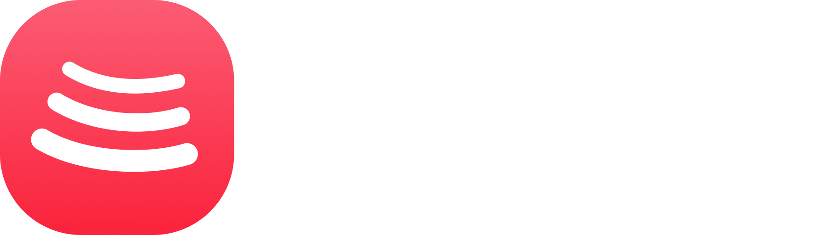

 
 

# ShitMate

### Premium Material 3 Music Client with Karaoke & Live Visualizer

 

 

[**Download**](#download) · [**Features**](#features) · [**Contributing**](#contributing) · [**Disclaimer**](#disclaimer)

> [!IMPORTANT]
> ShitMate is not affiliated with, endorsed by, or connected to YouTube or Google in any way. Use it at your own discretion.

---

<h1>Key Features</h1>

<table>
  <tr>
    <td width="50%" valign="top">

#### 🎵 Playback & DSP
- **Karaoke Mode / Vocal Suppressor** — Real-time vocal separation toggle directly in the player.
- **Neon Audio Visualizer** — Live animated audio waveform matching current frequencies.
- **True AMOLED Pitch Black Theme** — Optimized pure `#000000` dark mode for battery savings.
- **Smart Sleep Timer with Volume Fade** — Smooth gradual volume attenuation instead of abrupt stops.
- **Hi-Res lossless audio** — FLAC/ALAC playback with YouTube Music fallback.
- **Gapless playback with true crossfade** (0–12s).
- **Automix** — DJ-style beat-matched transitions.

    </td>
    <td width="50%" valign="top">

#### 🌐 Connectivity & Experience
- **Direct Sign-In** — Sign in with Google / YouTube Music directly on-device with Keystore AES-256 encryption.
- **Spotify Integration** — Connect Spotify to browse and play playlists and saved tracks.
- **Synchronized Lyrics** — Word-by-word highlighted lyrics with translation support.
- **Animated Album Canvas** — High-definition video canvas background playback.
- **Bit-Perfect USB Exclusive Output** — Direct bit-perfect DAC streaming.
- **Offline Downloads** — Save tracks with full metadata and high-res cover art.

    </td>
  </tr>
</table>

---

<h1>Download APK</h1>

Download the latest version directly from the [Releases](https://github.com/Dustu-Hub/ShitMate/releases) page.

| Architecture | Recommended For |
|---|---|
| **ShitMate-arm64.apk** | Modern Android devices (Android 8.0+) |
| **ShitMate-Universal.apk** | Universal build (All architectures) |

---

<h1>Disclaimer & Legal Notice</h1>

ShitMate is an independent third-party audio player and client. It is **not** associated with Google LLC or YouTube Music.

* **No Media Hosting:** ShitMate does not host, upload, or store copyrighted music files.
* **Open Source:** Released under the **GNU General Public License v3.0 (GPLv3)**.

